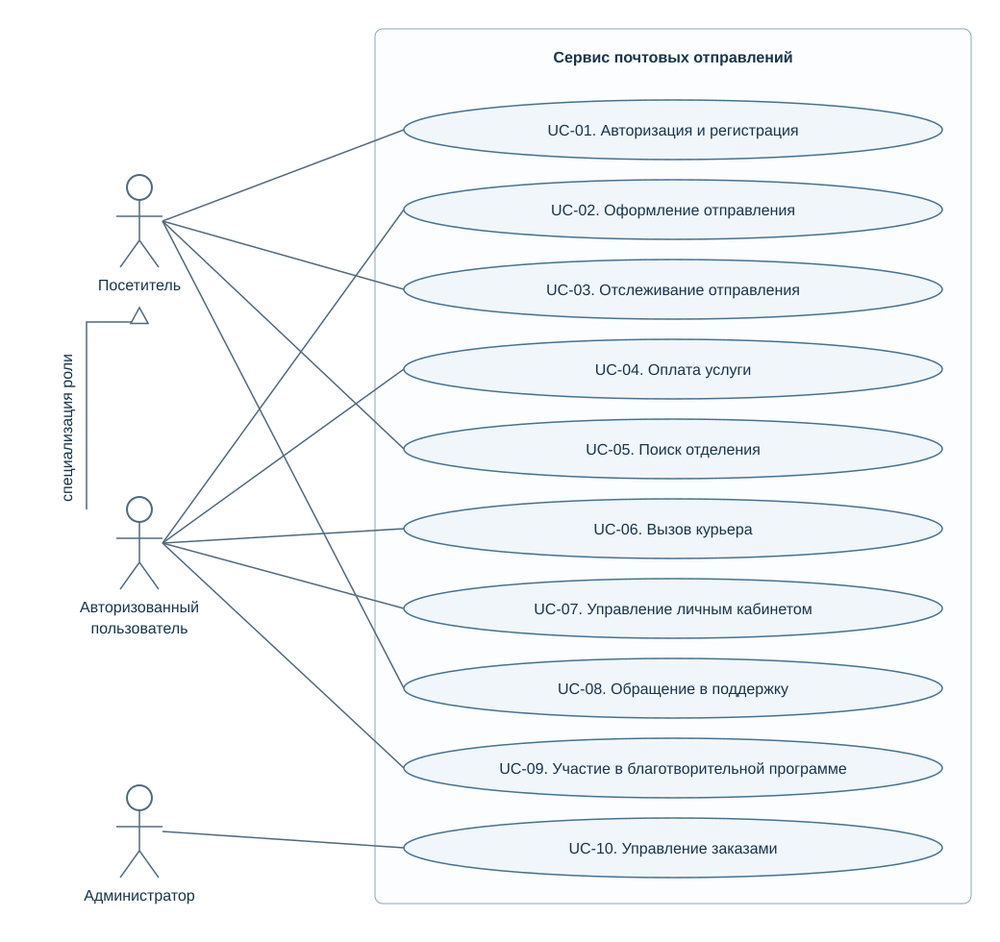

# Postal Service Requirements

**Елизавета Александровна Дьячкова · Университет ИТМО**

Аналитический проект: спецификация требований к веб-сервису почтовых отправлений. Описаны пользовательские роли, границы системы, функциональные и нефункциональные требования, сценарии использования, внешние зависимости и риски.

Основа - самостоятельный анализ открытого интерфейса сервиса «Почты России». Это авторская модель требований для портфолио: документ не является официальной спецификацией компании и не подтверждает устройство её внутренних систем.

## Задача

Представить пользовательские действия в виде согласованных требований: оформить отправление, рассчитать тариф, оплатить услугу, отследить посылку, найти отделение и вызвать курьера. Уточнить границы ответственности системы и поведение при ошибках.

## Результат

- Определены три роли: посетитель, авторизованный пользователь и администратор.
- Составлен каталог из **16 функциональных требований** с идентификаторами, приоритетами и критериями проверки.
- Подготовлены **10 сценариев использования**: предусловия, основной поток, альтернативы и постусловия.
- Описаны нефункциональные требования и проектные ограничения; целевые значения отделены от измеренных характеристик.
- Подготовлены UML Use Case диаграмма, матрица связей требований и сценариев, перечень рисков и открытых вопросов.

## Документация

| Артефакт | Содержание |
|---|---|
| [Спецификация SRS](docs/requirements.md) | Область применения, роли, требования, зависимости и допущения |
| [Сценарии использования](docs/use-cases.md) | 10 основных сценариев и обработка исключений |
| [Матрица трассировки и проверок](docs/traceability.md) | Требование → сценарий → критерий приёмки |
| [Риски и открытые вопросы](docs/risks-and-decisions.md) | Неопределённости, меры снижения рисков, решения для согласования |
| [Описание доработок](docs/revision-notes.md) | Что уточнено при подготовке версии для портфолио |

## Диаграмма вариантов использования



[Редактируемый исходник PlantUML](diagrams/use-cases.puml). Линии показывают участие ролей в сценариях. Специализация авторизованного пользователя означает доступ к публичным функциям посетителя; администратор моделируется отдельной ролью.

## Подход

SRS, декомпозиция требований, функциональные и нефункциональные требования, UML Use Case, описание основных и альтернативных потоков, приоритизация MoSCoW и трассировка.

Документацию можно читать прямо на GitHub. Программная реализация и испытания сервиса в этот проект не входят. Критерии приёмки - описание ожидаемых проверок, а не отчёт об их прохождении.

## Структура

```text
README.md
docs/
  requirements.md
  use-cases.md
  traceability.md
  risks-and-decisions.md
  revision-notes.md
diagrams/
  use-cases.svg
  use-cases.puml
```

## Источник и ограничения

Предметная область и начальный перечень функций взяты из авторской спецификации SRS от 2026 года по открытому сервису [pochta.ru](https://www.pochta.ru/). Исходный документ переработан для согласованности и проверяемости. Внутренние API, инфраструктура и реальные показатели нагрузки компании не исследовались. Численные цели и предлагаемые правила явно отмечены в спецификации.
